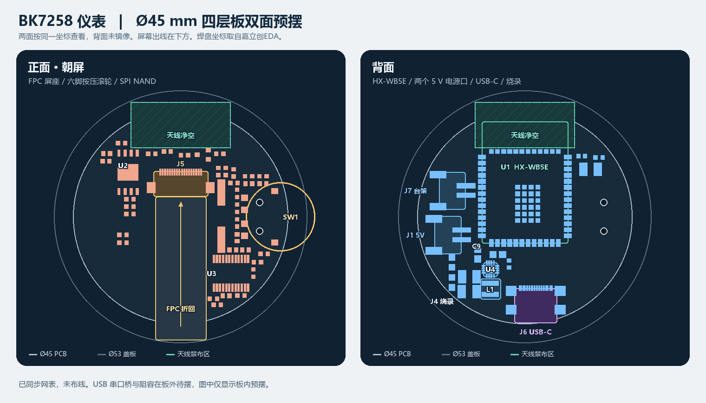

# BK7258 仪表 · Ø45 mm PCB 双面预摆

嘉立创EDA 工程：**BK7258 仪表 → BK7258_Carrier_RevA_SCH → PCB1**。四铜层、双面贴，Ø45.0 mm 板框与 Ø53 mm 屏盖板同心。下图以板框圆心为坐标原点，屏幕出线侧为 −Y，两面共用坐标，背面未镜像。

[下载嘉立创EDA 工程](BK7258-Dashboard.epro2)。原理图说明已改为中文。PCB1 已同步双电源选择，仍是未布线的预布局；原理图的最新复位触点改动还需同步到 PCB1。下图是同步双电源选择前的预摆记录。

J1 接外置 DC/DC 或台架电源的稳压 **5 V**，不直接接 12 V。USB-C 的 VBUS 保留给 CP2102N，同时作为 U7（[TPS2116DRLR](https://www.ti.com/lit/ds/symlink/tps2116.pdf)）的备用电源输入。U7 优先选有效的 J1 电源，输出 `VIN_5V` 给 U4；原 J7 已取消。布局时把 C25 靠近 U7 的 VIN1，把原有 C19/C20 放在 USB VBUS 路径上，确认至 VIN2 的走线够短。USB 单线供电的启动峰值待实测。

烧录和调试共用 J6 USB-C → CP2102N → UART0。原理图已删四针 J4，改为两个无需贴装的裸焊盘：TP1（`BK_CEN`）和 TP2（`GND`）。烧录时保持 USB-C 连接，按烧录工具提示将两点短接后松开，复位 BK7258。PCB1 图中仍可看到同步前的 J4；同步后把两个复位触点放在便于接触的位置。

| 位号 | 安排 |
| --- | --- |
| U1 HX-WB5E | 背面 (0, +7.25) mm，18 × 25.5 mm，天线朝 +Y；全层保留天线禁走线和覆铜区。模组最外角到圆板边约 0.57 mm。结构定型时核对屏背、外壳和线束对天线的影响。 |
| J5 屏幕 FPC | 正面 (0, +7.75) mm，入口朝 −Y。Hirose FH12-18S-0.5SH(55)，18 芯、0.50 mm、下接触。 |
| J6 USB-C | 背面 (2.25, −17.20) mm，接口朝 −Y 板边。GCT USB4110-GF-A，座高约 3.26 mm。定壳时检查定位柱、插头包胶和插拔空间。 |
| J1 / J7 电源口 | 背面左侧，中心分别为 (−16.1, −3.8) mm / (−15.2, +5.5) mm；两者用同款侧插 JST PH 两针座，丝印分别标为 J1 5V ONLY 和 J7 BENCH 5V。 |
| SW1 / J4 | 六脚侧拨按压滚轮在正面，轮缘约伸出 Ø53 屏盖板 1.6 mm。背面西南侧 J4 为 UART0/RST 烧录触点。 |

屏背到 PCB 正面按 **3 mm 净距**。沃乐康 W180TE010I-18Z(CTP-A1) 规格书第 6 页标注尾排展开 38 ± 0.5 mm、折回投影 35.7 ± 0.5 mm，尾排补强 0.30 ± 0.03 mm。按参考折法，尾端约在 Y = +9.8～+10.0 mm；按 J5 止点 Y ≈ +7.5 mm 估算，名义平面余量约 **2.3～2.5 mm**。锁扣闭合高度约 2.0 mm，开启参考高度约 4.8 mm。先插排线并锁好，再叠装 PCB 和屏；用实物确认排线弧度、金手指朝向和插深。

U4 为 TPS62142RGTR（固定 3.3 V，2 A 芯片额定），L1 为 2.2 µH XFL4020-222MEC；C9/C10 各 10 µF、16 V、X7R、0805。C13/C14 为 22 µF、25 V X7R，C12 为 3.3 nF 软启动电容，R22 为 PWR_GOOD 上拉。车载反接、浪涌和 5 V 线束过流保护由外置电源和上游保险承担。

两路业务 UART 保留原理图信号，PCB 暂不放插座。USB 串口桥及周边件仍需完成摆放；Y1 仍需核对实际晶振型号和封装。尚未布线或打板，结构、线束压降、启动电流和 USB-C 实际烧录仍需验证。

资料：HX-WB5E 模组尺寸图；沃乐康 W180TE010I-18Z(CTP-A1) 规格书第 6 页；[Hirose FH12](https://www.hirose.com/en/product/p/CL0586-0530-1-55)、[GCT USB4110](https://gct.co/connector/usb4110)、[JST PH](https://www.jst-mfg.com/product/pdf/eng/ePH.pdf)、[TI TPS62142](https://www.ti.com/lit/ds/symlink/tps62142.pdf)、[Coilcraft XFL4020-222](https://www.coilcraft.com/en-us/products/power/high-voltage-inductors/xfl/xfl4020/xfl4020-222/)、[TI TXU0202](https://www.ti.com/lit/ds/symlink/txu0202.pdf)。
