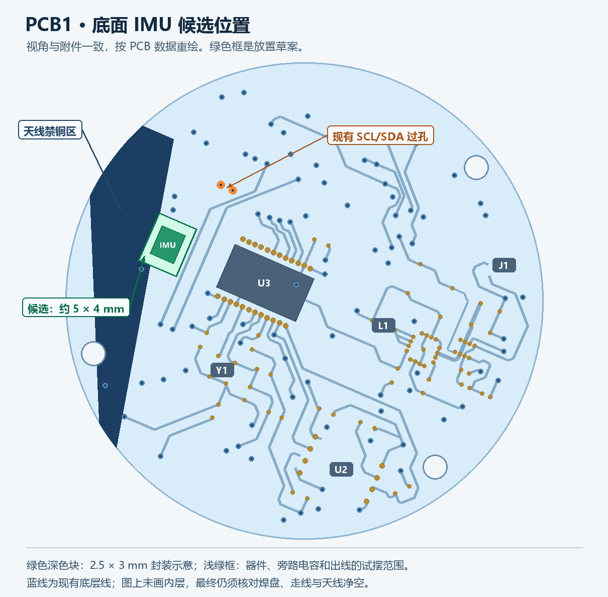

# PCB1 底面 IMU 扩展建议 · 2026-11-14

当前 P1 原理图已保存：U8 旁的 C26、C27 已换为 0603 100 nF（C14663），C28 保留原有 0603 10 µF（C19702）。已核对三颗的网络仍为 `VDD_3V3` 和 `GND`，不贴装设置保留。本次没有同步或修改 PCB。以下为最初的选型和摆放记录。

可利用天线禁铜矩形与 U3 之间的空地。**仅做简单倾角显示时，优先试摆 LIS2DW12TR（C189624，2 × 2 mm）。** 共用触摸 I²C（P20/P21），保留现有上拉，轮询三轴加速度即可，不占额外 GPIO。装车后把车身扶正校零，按安装方向对应芯片坐标轴；先用 ±2g 坐标数据低通后计算左右倾角。加速、刹车、持续转弯会影响加速度算出的角度，低通只能抑制部分振动。[倾角计算原理](https://www.analog.com/en/resources/app-notes/an-1057.html)

手头已有 MPU6050 模块可先用它验证显示。裸芯片 `MPU-6050`（C24112）也支持 I²C，AD0 拉低地址为 `0x68`；但 4 × 4 mm 的 QFN 芯片本体已经几乎占满候选框短边，焊盘和外部电容还要空间，若采用它需另试摆。TDK 已将该型号停产，因此新板优先考虑尺寸更小、仍在产的 LIS2DW12TR。[MPU6050 数据手册](https://invensense.tdk.com/wp-content/uploads/2015/02/MPU-6000-Datasheet.pdf) · [TDK 停产通知](https://invensense.tdk.com/wp-content/uploads/2023/09/PCN-000614.pdf)

下图仍使用原先 2.5 × 3 mm 六轴芯片的轮廓示意候选位置。芯片和旁路电容应留在净空之外。这是只读方案，没有改原理图、PCB 或固件。

绿框候选范围约 **5.08 × 4.06 mm**，中心约 X=51.05 mm、Y=65.15 mm（EDA PCB 坐标，原点以源文件为准）。用在天线与横过板底的 UART0 线之间；绿框天线侧边界距现有禁铜矩形约 1.52 mm，最靠近 UART0 TX 的边与现有走线铜边约 0.25 mm。两个距离只是源文件里这个试摆框的几何关系，既不是射频净空指标，也不是实际焊盘或走线的 DRC 结论。散件可优先靠 U3 一侧摆，封装、所有新铜、过孔及屏蔽金属都要避开天线净空；同时核对壳体、螺钉与 PCB 板弯。图里只画了底层走线、过孔和底面器件位置。试走线时注意底面的 UART0 RX/TX 横在候选区和 I²C 过孔之间，确认能在其他层跨过，避免切断地参考面。

| 选择 | 接法 | 适合做什么 |
| --- | --- | --- |
| ICM-42670-P，C3288646 | 2.5 × 3 mm，3.3 V I²C，AD0 接地时 7 位地址 `0x68`。首样定时读，INT1 留焊盘或经可选 0 Ω 接空闲 GPIO。 | 车身振动、转动趋势、倾角界面和记录；倾角须在装车后标定，转弯时的离心加速度等会影响估算。仪表若固定在转向机构上，测到的是仪表随车把的运动。 |
| LIS2DW12TR，C189624 | 2 × 2 mm，I²C 地址 `0x18` / `0x19`，和上面不是兼容封装。 | 简单倾角显示、振动或搬动检测。若整板断电，运动中断不能直接唤醒仪表，需要另有常供电和唤醒电路。 |

首选共享触摸 I²C：**U1.4 / P20 = `TP_SCL`，U1.5 / P21 = `TP_SDA`**，原有过孔坐标分别为 `(1720,2470)`、`(1720,2420)` mil。触摸用的是 `0x15`，与两款都不冲突。保留 R11/R12 各 4.7 kΩ 上拉到 `VDD_3V3`，不在 IMU 分支再加一对上拉。可以在分支各放一个 0 Ω，便于首板断开。ICM-42670-P 的 VDD 和 VDDIO 接 3.3 V，CS 接 VDDIO，FSYNC 不用时接地，AD0 接地；旁路按 TDK 参考图靠近电源脚摆放。

固件让触摸和 IMU 使用同一个总线入口，先用 100 kHz，事务串行执行。触摸驱动已有 GPIO 开漏回退，现用后端是硬件或 GPIO 时，两者都要走同一套总线状态，避免互相重新配置引脚。样板先读 ICM 的 `WHO_AM_I`（`0x75` 应返回 `0x67`），再一边连续触摸滑动一边采数，看看两类设备是否有超时或丢数据。

想完全隔开触摸的话，核对到旧 QSPI0 的 **U1.6/7/8/9/10/52 = P22/23/24/25/26/27** 当前 PCB 焊盘无网，其中 P22/P23 可做软件开漏 I²C，另配上拉，P24 可作为 `IMU_INT1` 候选。要先解除 SDK 默认复用；P22/P23 不是硬件 I²C 引脚。硬件 I²C1 的 P0 已给背光；另一组 P38/P39 在模组腹部焊盘 70/73，走线和 SDK 复用配置都需要另行验证。为这一块 IMU，从现有总线分支的改动更小。

参考：[TDK ICM-42670-P 产品与资料](https://www.invensense.tdk.com/fr-fr/products/6-axis/icm-42670-p)、[TDK 接线及寄存器手册](https://invensense.tdk.com/wp-content/uploads/2021/07/DS-000451-ICM-42670-P-v1.0.pdf)、[TDK PCB 与装配指南](https://invensense.tdk.com/wp-content/uploads/documentation/AN-000393_TDK-InvenSense-IMU-PCB-Design-and-MEMS-Assembly-Guidelines.pdf)、[ST LIS2DW12](https://www.st.com/en/mems-and-sensors/lis2dw12.html)、[嘉立创 ICM-42670-P](https://jlcpcb.com/partdetail/ICM-42670-P/C3288646)、[嘉立创 LIS2DW12TR](https://jlcpcb.com/partdetail/LIS2DW12TR/C189624)。嘉立创这两料当前页面均标为标准贴装；下单时核对装配选项。
